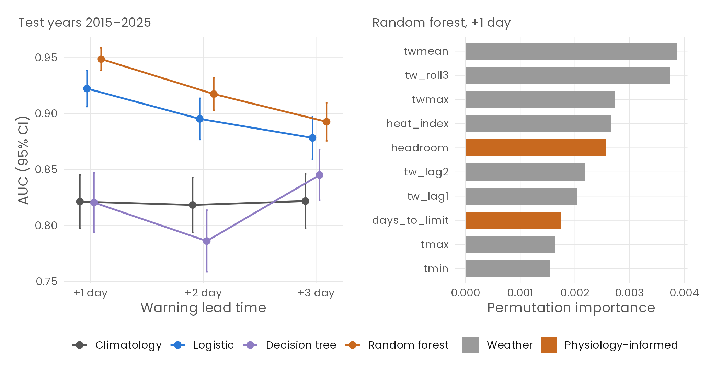
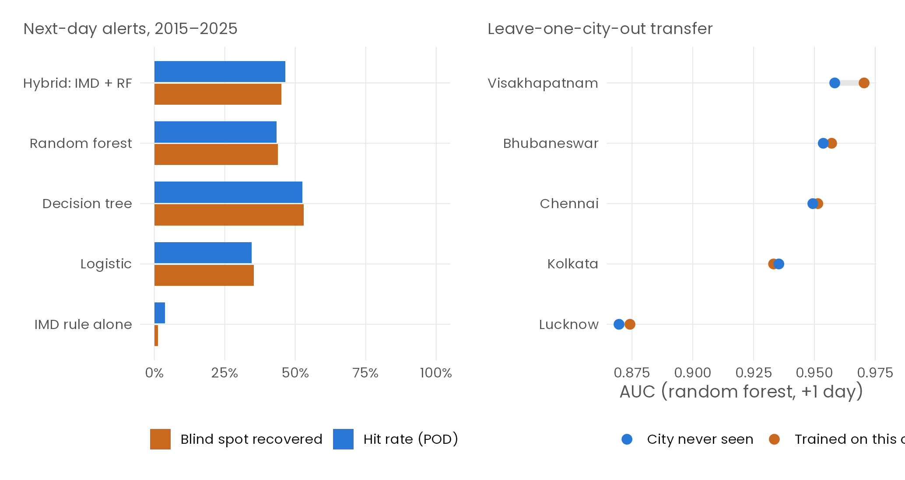

# SilentHeat

**India's heatwave rule only looks at the thermometer. SilentHeat measures the humid heat it misses, and forecasts it.**

India declares a heatwave on **dry-bulb** temperature alone: 40 °C on the plains or 37 °C on the coast, plus a 4.5 °C departure from normal. That declaration is what switches on Heat Action Plans. But the body cools by evaporating sweat, and humid air stops that. Lab physiology (Vecellio et al., 2022) puts the limit for healthy young adults at a **wet-bulb temperature of about 30–31 °C**. A 36 °C afternoon at 60% humidity sits right at that edge, and the official rule calls it an ordinary day.

SilentHeat audits 45 years of weather across 10 Indian cities to answer three questions: how much dangerous humid heat does the rule miss, is the miss getting worse, and can probability and ML models close it?

<p align="center"></p>

## Key results

10 cities · 1981–2025 · 164,360 city-days of ERA5 reanalysis

| | Question | Finding |
|---|---|---|
| **RQ1** | How much does the IMD rule miss? | **96.3%** of dangerous humid-heat days (wet-bulb ≥ 29 °C) were never heatwave days (703 of 730; 95% CI 94.7–97.4%). Cohen's κ ≈ 0. |
| **RQ2** | Is it getting worse? | Danger days grow **×1.54 per decade** (negative binomial, 95% CI 1.34–1.77). April–June wet-bulb is up 0.53 °C since the 1980s. |
| **RQ3** | Are the extremes moving? | GEV location shift is significant in 7 of 10 cities. Chennai's 1-in-50-year humid extreme of 1985 now returns every **2.6 years**. |
| **RQ4** | Does danger come in spells? | Strong day-to-day persistence (odds ratio 27–41). In Chennai, P(≥ 3-day spell per season) rose from 2% to 23%. |
| **RQ5** | Can a simple model warn a day ahead? | Logistic regression: **AUC 0.92** vs 0.61 for the IMD rule, calibrated, Brier skill +17% over climatology. |
| **RQ6** | Can baseline ML do better, further ahead? | Random forest: **AUC 0.95** one day ahead and 0.89 three days ahead. Details below. |

## The ML layer (RQ6)

Three baseline classifiers (logistic regression, a decision tree, and a random forest) predict whether the day **+1, +2 or +3 days ahead** will cross the 29 °C wet-bulb danger line. They are compared against climatology and the IMD rule. Models train on 1981–2014, alert thresholds are tuned on 2010–14, and every score comes from 2015–2025, which the models never saw.

<p align="center"></p>

### What is new

1. **Physiology-informed features.** Each day also carries its *headroom* to the 29 °C limit, how fast that headroom is closing, and the implied days-to-limit. Headroom ranks 5th of 24 features in the forest.
2. **A hybrid alert, not a replacement.** Keep the IMD rule and add an ML layer on top. Score it on *blind-spot recovery*: the share of danger days the IMD rule cannot see that the hybrid catches. Result: **45%**, against 1% for the rule alone.
3. **Zero-history cities.** Leave each city out entirely, train on the rest, and forecast it. The forest still reaches a mean AUC of **0.93**, against 0.94 with local data, so the warning can run where no labelled history exists.

<p align="center"></p>

The honest cost: 64% of hybrid alerts are false alarms. That is fine for a cheap "hydrate and rest" advisory, but not for closing schools.

## Quick start

Needs R ≥ 4.3. The raw downloads are cached in `data/raw/`, so everything runs offline.

```bash
Rscript install.R                     # install the 17 R packages used
Rscript run_all.R                     # features → 6 analyses → ML → figures → report  (~1.5 min)
Rscript -e 'shiny::runApp("app")'     # interactive dashboard
uv run --with python-pptx --with pillow python presentation/build_deck.py   # rebuild the slides
```

## Project structure

```
silent-heat/
├── run_all.R                 one command: rebuilds every table, figure and the report
├── install.R                 R package dependencies
├── R/
│   ├── 00_setup.R            shared helpers written from scratch: GEV likelihood and return levels,
│   │                         Mann–Kendall + Sen, Wilson CI, Cohen's κ, Stull wet-bulb, NWS heat index
│   ├── 01_fetch_data.R       ERA5 via the Open-Meteo API (retries, cache)
│   ├── 02_build_features.R   harmonic climate normals, IMD heatwave rule, humid-heat flags
│   ├── 03_eda.R              descriptive statistics, Tmax–RH correlation, wet-bulb regression
│   ├── 04_distribution_fit.R Normal / Gamma / Weibull / Lognormal MLE, Poisson vs negative binomial
│   ├── 05_blind_spot.R       RQ1  miss rates (Wilson, exact, block bootstrap, Bayes), χ², McNemar, κ
│   ├── 06_trends.R           RQ2  Mann–Kendall, NB GLM, era tests, ANOVA + Tukey, Friedman
│   ├── 07_extremes_gev.R     RQ3  GEV MLE (checked against evd::fgev), non-stationary GEV + LRT
│   ├── 08_markov_spells.R    RQ4  two-state Markov chain, geometric spells, Monte Carlo
│   ├── 09_early_warning.R    RQ5  logistic warning, Brier skill, ROC/DeLong, reliability
│   ├── 10_ml_models.R        RQ6  decision tree, random forest, hybrid alert, leave-one-city-out
│   └── 11_render_report.R    knit the report to HTML and PDF
├── app/app.R                 Shiny dashboard: blind spot · trends · extremes · risk calculator
├── data/
│   ├── raw/                  cached ERA5 downloads, one CSV per city
│   └── processed/            daily feature table (RDS)
├── outputs/
│   ├── tables/               ~40 result tables (CSV/RDS)
│   └── figures/              every figure twice: deck/ (dark) and report/ (light)
├── report/                   written report (Rmd → HTML/PDF); every number is pulled from outputs/
├── presentation/             SilentHeat.pptx + PDF, and the script that builds them
└── docs/                     one-page project brief
```

## Data and limitations

- **Data:** ERA5 reanalysis (Hersbach et al., 2020) via [Open-Meteo](https://open-meteo.com/), CC BY 4.0. Daily max/min temperature, wet-bulb and humidity at the grid cell nearest each city.
- **Smoothing:** ERA5's 0.25° grid smooths local peaks, so station data would raise every count. The split between dry heat and humid heat is structural, though.
- **Lower bounds:** the IMD rule is applied to one grid cell rather than two stations. That is more generous to IMD, so the miss rates are lower bounds.
- **Who the threshold fits:** the wet-bulb limits come from young, healthy adults. Older people and outdoor workers are at risk sooner.
- **ML scope:** the ML models cover the 5 cities with at least 20 danger days. Elsewhere the outcome is almost always zero.

## References

- Vecellio, D. J. et al. (2022). Evaluating the 35 °C wet-bulb temperature adaptability threshold for young, healthy subjects. *Journal of Applied Physiology*.
- Raymond, C., Matthews, T. & Horton, R. M. (2020). The emergence of heat and humidity too severe for human tolerance. *Science Advances*.
- Pillai, A. V. & Dalmia, T. (2023). *How is India adapting to heatwaves?* Centre for Policy Research.
- Hersbach, H. et al. (2020). The ERA5 global reanalysis. *QJRMS*.

---

Arhaansh Jhingan · 25BCE0541 · VIT Vellore · Probability & Statistics Lab
