## Abstract

India declares a heatwave only when the **dry-bulb** temperature crosses a fixed threshold: 40 °C on the plains or 37 °C on the coast, together with a 4.5 °C departure from normal. That declaration is what activates city and state Heat Action Plans. But the body's ability to shed heat is governed by **humid heat**, measured by the wet-bulb temperature (Tw). We built a fully reproducible R pipeline over 164,360 city-days of ERA5 reanalysis (10 Indian cities, 1981–2025). It applies the official IMD rule day by day and audits it against a physiological humid-heat criterion (daily maximum Tw ≥ 29 °C).

Of the **730 dangerous humid-heat days** we found, **703 (96.3%, Wilson 95% CI 94.7%–97.4%) were never IMD heatwave days**. Agreement between the two definitions is essentially zero (Cohen's κ -0.00–0.09). The miss rate is statistically the same across cities and between coastal and plains rules. It stays at 96–99% for every threshold we tried, including each city's own 95th/99th percentile. Meanwhile, danger days are increasing by **54% per decade** (negative-binomial IRR 1.54, 95% CI 1.34–1.77). Under a non-stationary GEV model, Chennai's 1-in-50-year humid-heat extreme of 1985 is now a **1-in-2.6-year** event. A simple logistic early-warning model gives a calibrated next-day probability with AUC 0.92, against 0.61 for the IMD rule's state. All analysis, figures, this report and an interactive Shiny dashboard are produced in R.

## 1. The gap

**In practice.** IMD's heatwave criteria are dry-bulb only. A 2023 Centre for Policy Research review of 37 Heat Action Plans across 18 states found that only 10 set locally defined thresholds. It also found that plans focus on dry heat and largely ignore humid heat and warm nights. IMD does publish an *experimental* Heat Index (NOAA-style, colour-coded green/yellow/orange/red), but it is guidance only. It does not trigger the heatwave declaration, and it gives no probabilities or return periods.

**In the physiology.** Laboratory work (Vecellio et al., 2022) puts the critical wet-bulb limit for young, healthy adults in warm-humid air at about 30–31 °C, well below the theoretical 35 °C. Observational work (Raymond et al., 2020) shows that extreme humid heat has more than doubled in frequency since 1979.

**The unanswered question.** How much physiologically dangerous humid heat falls outside India's official heatwave rule? Is that blind spot growing, and can probability modelling close it?

| Research question | Statistical tools (all in R) |
|---|---|
| **RQ1** What share of dangerous humid-heat days does the IMD rule miss? | Wilson / exact / year-block bootstrap CIs, Beta–Binomial posterior, χ² / Fisher, McNemar, Cohen's κ, two-proportion test |
| **RQ2** Are danger days becoming more frequent? | Mann–Kendall + Sen's slope (own code), Poisson vs negative-binomial GLM, Wilcoxon, Welch t, KS, permutation test, two-way ANOVA + Tukey, Friedman |
| **RQ3** How extreme can humid heat get, and is the tail shifting? | GEV maximum likelihood (own optimiser code), Gumbel LRT, delta-method + parametric bootstrap return levels, non-stationary GEV |
| **RQ4** Do dangerous days cluster into spells? | Two-state Markov chain, χ² / G² dependence tests, geometric spell law, Monte Carlo simulation |
| **RQ5** Can we warn a day ahead, with honest probabilities? | Logistic regression, temporal hold-out, Brier skill, ROC/AUC (DeLong), reliability diagram |

## 2. Data

Daily ERA5 reanalysis (0.25°) was downloaded from the Open-Meteo archive API by `R/01_fetch_data.R`. The window is 1 Jan 1981 to 31 Dec 2025 for ten cities: seven judged by IMD's plains rule (Delhi, Lucknow, Ahmedabad, Nagpur, Kolkata, Bhubaneswar, Vellore) and three by the coastal rule (Chennai, Mumbai, Visakhapatnam). Variables: daily max/min temperature, daily max/mean wet-bulb temperature, and daily min/mean relative humidity. The dataset has no missing values.

*Physics check.* We recomputed wet-bulb temperature independently from (Tmax, RHmin) with Stull's (2011) formula. It correlates with ERA5's daily maximum Tw at r = 0.96–0.99 in every city (mean offset 0.51 °C), so the humid-heat signal is physically consistent.

*Climatological normal.* IMD judges departures from a station's normal. We estimate each city's normal Tmax over the WMO 1991–2020 base period with a 3-harmonic regression, $T_{max} = \beta_0 + \sum_{k=1}^{3} [a_k \sin(2\pi k\,d/365.25) + b_k \cos(2\pi k\,d/365.25)]$, with R² = 0.56–0.85.

*The IMD rule as coded.* Plains: Tmax ≥ 40 °C and departure ≥ 4.5 °C, or Tmax ≥ 45 °C. Coastal: Tmax ≥ 37 °C and departure ≥ 4.5 °C. Either way, the condition must hold on ≥ 2 consecutive days. We use one grid cell rather than IMD's two stations per subdivision, which makes our version **more generous to IMD**. Every miss rate below is therefore a conservative lower bound.

## 3. Exploratory analysis: why a dry-bulb rule cannot see humid heat

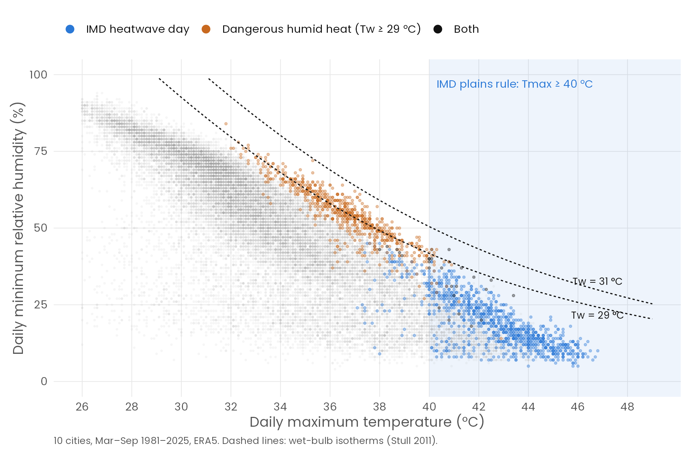

*Figure 1.* Each dot is a city-day (March–September). IMD heatwave days (blue) live in the hot-dry corner. Dangerous humid-heat days (orange) sit along the 29 °C wet-bulb isotherm at 32–39 °C and 40–70% humidity, a region the dry-bulb rule never enters. Only 27 of 990 IMD heatwave days were also humid-danger days.

Temperature and humidity are strongly **negatively** correlated on hot-season days in every city (Pearson r from -0.91 to -0.61, all p < 0.001; Spearman agrees). In other words, the hottest days are the driest days, so a threshold on temperature alone systematically selects dry heat. A multiple regression of daily max Tw on Tmax and RHmin (R² 0.76–0.94) shows that +10 percentage points of humidity raises Tw by 1.5–2.1 °C at fixed temperature. In standardised terms, humidity is as important a driver as temperature.


|City          |IMD rule | Mean Tmax| Mean Tw max| SD Tw max| Max Tw|  Skew| Danger d/yr| IMD HW d/yr| Silent d/yr|
|:-------------|:--------|---------:|-----------:|---------:|------:|-----:|-----------:|-----------:|-----------:|
|Delhi         |Plains   |     34.66|       23.63|      3.78|   29.9| -0.74|        0.29|        5.27|        0.29|
|Lucknow       |Plains   |     34.37|       24.41|      3.58|   31.3| -0.91|        0.69|        6.07|        0.67|
|Ahmedabad     |Plains   |     35.21|       24.15|      2.97|   28.7| -1.21|        0.00|        1.38|        0.00|
|Nagpur        |Plains   |     34.61|       23.47|      2.56|   28.3| -0.88|        0.00|        3.98|        0.00|
|Kolkata       |Plains   |     32.73|       26.61|      1.97|   31.0| -1.89|        6.84|        1.11|        6.64|
|Bhubaneswar   |Plains   |     33.49|       26.54|      1.49|   30.9| -1.17|        3.58|        1.53|        3.33|
|Vellore       |Plains   |     35.12|       24.30|      1.32|   29.5| -1.28|        0.02|        0.18|        0.02|
|Chennai       |Coastal  |     34.19|       26.03|      1.22|   30.8| -0.39|        1.42|        0.13|        1.40|
|Mumbai        |Coastal  |     30.15|       25.26|      1.39|   29.3| -1.38|        0.04|        0.40|        0.04|
|Visakhapatnam |Coastal  |     32.34|       26.39|      1.30|   30.3| -0.63|        3.33|        1.96|        3.22|

*Table 1.* Descriptive statistics, March–September 1981–2025 (°C; d/yr = days per year).

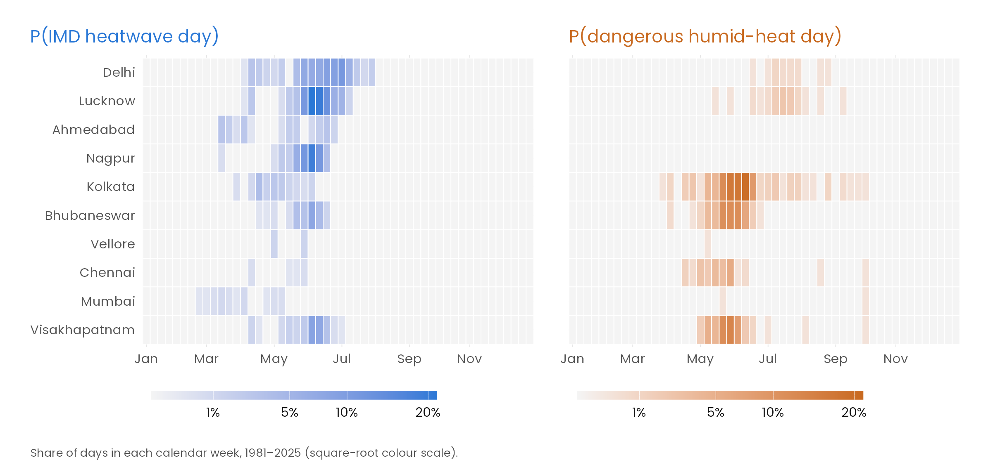

*Figure 2.* Probability of each event by calendar week. The IMD heatwave season (north and central India, April–June) and the humid-danger season (east coast and Kolkata, May–July) barely overlap.

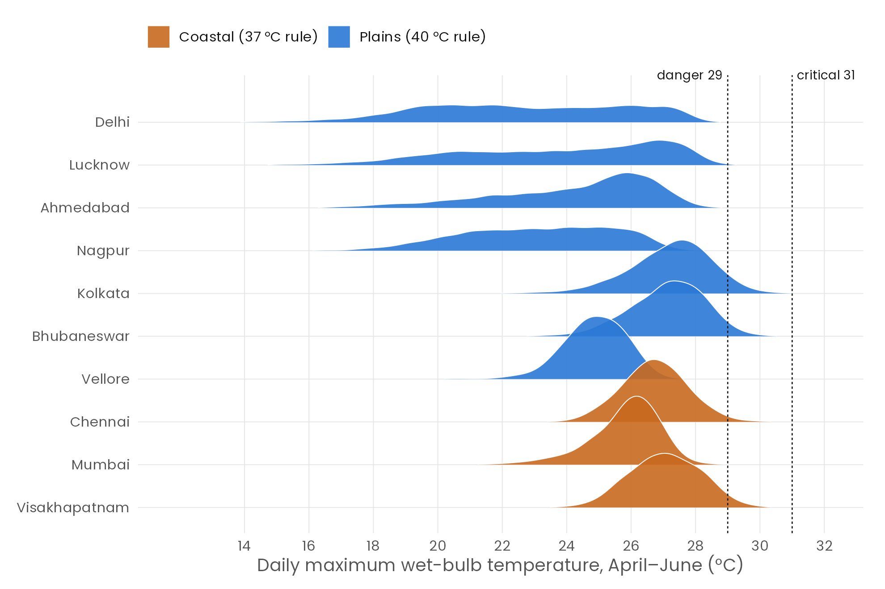

*Figure 3.* April–June distribution of daily maximum wet-bulb temperature. The distributions are left-skewed (skewness −0.4 to −1.9), with coastal and eastern cities pressed against the danger line.

## 4. Which probability model fits?


|City    |Distribution |     log L|      AIC|     ΔAIC|  KS D| Anderson–Darling|
|:-------|:------------|---------:|--------:|--------:|-----:|----------------:|
|Chennai |Normal       | -1746.335| 3496.670|    6.959| 0.050|            2.537|
|Chennai |Gamma        | -1743.756| 3491.512|    1.801| 0.047|            2.178|
|Chennai |Weibull      | -1904.186| 3812.372|  322.661| 0.103|           27.954|
|Chennai |Lognormal    | -1742.856| 3489.711|    0.000| 0.045|            1.973|
|Delhi   |Normal       | -3048.830| 6101.660|    0.000| 0.041|            2.806|
|Delhi   |Gamma        | -3063.582| 6131.164|   29.504| 0.045|            3.746|
|Delhi   |Weibull      | -3053.921| 6111.843|   10.182| 0.064|            5.841|
|Delhi   |Lognormal    | -3074.157| 6152.314|   50.654| 0.048|            4.581|
|Kolkata |Normal       | -1990.829| 3985.658|    0.000| 0.052|            2.991|
|Kolkata |Gamma        | -2582.317| 5168.633| 1182.975| 0.214|          150.018|
|Kolkata |Weibull      | -2025.139| 4054.278|   68.620| 0.059|            6.541|
|Kolkata |Lognormal    | -2000.847| 4005.694|   20.036| 0.060|            4.480|

*Table 2.* Maximum-likelihood fits to daily max Tw in May (`fitdistrplus`). No single family wins everywhere, and the Anderson–Darling statistics stay large. The bulk fits miss the tail that matters for health, which is why we model extremes directly with extreme-value theory (Section 7).

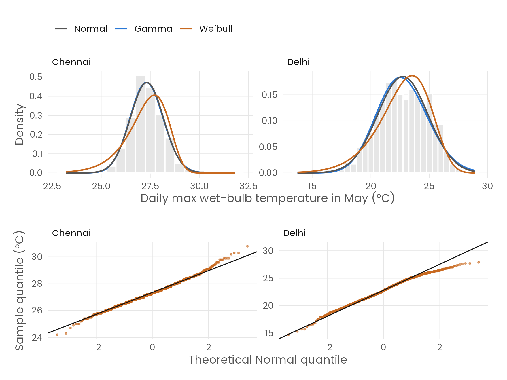

*Figure 4.* Histograms with fitted Normal, Gamma and Weibull densities, plus Normal Q–Q plots. Departures are concentrated in the tails.

For the **annual count of danger days**, the variance exceeds the mean by a factor of 2.0–9.0. The dispersion test rejects the Poisson model in every city (p < 0.001), and a negative binomial is preferred by AIC and by a boundary-corrected likelihood-ratio test. We therefore use the negative binomial for trend inference.


|City          | Mean| Variance| Var/mean|Dispersion p | AIC Poisson| AIC NegBin|LRT p   |
|:-------------|----:|--------:|--------:|:------------|-----------:|----------:|:-------|
|Bhubaneswar   | 3.58|    21.52|     6.02|< 0.001      |      338.65|     217.27|< 0.001 |
|Chennai       | 1.42|    12.79|     9.00|< 0.001      |      259.77|     122.74|< 0.001 |
|Delhi         | 0.29|     0.57|     1.99|< 0.001      |       70.80|      59.37|< 0.001 |
|Kolkata       | 6.84|    51.09|     7.46|< 0.001      |      411.51|     271.87|< 0.001 |
|Lucknow       | 0.69|     1.76|     2.56|< 0.001      |      121.17|     104.07|< 0.001 |
|Visakhapatnam | 3.33|    17.32|     5.20|< 0.001      |      304.27|     213.63|< 0.001 |

## 5. RQ1: The blind spot

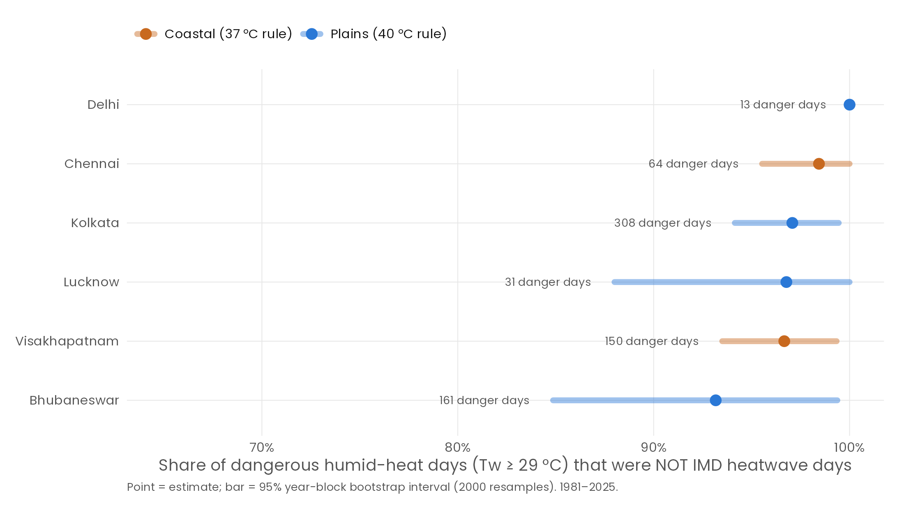

*Figure 5.* Share of danger days that were not IMD heatwave days, with 95% year-block bootstrap intervals. Whole years are resampled to respect day-to-day dependence.


|City          | Danger days| Missed|Miss rate |Wilson 95% CI  |Bootstrap 95% CI |Bayes 95% CrI |Cohen κ |McNemar p |HI ≥ orange |
|:-------------|-----------:|------:|:---------|:--------------|:----------------|:-------------|:-------|:---------|:-----------|
|Bhubaneswar   |         161|    150|93.2%     |88.2% – 96.1%  |84.9% – 99.4%    |88.2% – 96.1% |0.090   |< 0.001   |96%         |
|Chennai       |          64|     63|98.4%     |91.7% – 99.7%  |95.5% – 100.0%   |91.7% – 99.6% |0.028   |< 0.001   |41%         |
|Delhi         |          13|     13|100.0%    |77.2% – 100.0% |100.0% – 100.0%  |76.8% – 99.8% |-0.002  |< 0.001   |46%         |
|Kolkata       |         308|    299|97.1%     |94.5% – 98.5%  |94.1% – 99.4%    |94.5% – 98.4% |0.045   |< 0.001   |87%         |
|Lucknow       |          31|     30|96.8%     |83.8% – 99.4%  |88.0% – 100.0%   |83.8% – 99.2% |0.003   |< 0.001   |45%         |
|Visakhapatnam |         150|    145|96.7%     |92.4% – 98.6%  |93.5% – 99.3%    |92.4% – 98.5% |0.036   |< 0.001   |81%         |

*Table 3.* Cities with at least 10 danger days. The Bayesian column uses a Beta(1,1) prior, giving a Beta(1 + missed, 1 + caught) posterior. "HI ≥ orange" is the share of danger days on which IMD's own experimental Heat Index reached orange or red.

* **Pooled:** 703 of 730 danger days were missed (96.3%).
* **Agreement:** Cohen's κ is close to 0 everywhere, so the two definitions measure *different hazards*. McNemar's test confirms that the disagreement is systematic (p < 0.05 in every city).
* **Homogeneity:** a χ² test of equal miss rates across cities (Monte Carlo p = 0.33) and a two-proportion test of coastal vs plains (p = 0.52) find no difference. The blind spot is a property of the rule, not of one region.
* **Robustness:** the pooled miss rate is 98%, 98%, 99%, 98%, 96%, 97% for thresholds Local P95, Local P99, Tw ≥ 27, Tw ≥ 28, Tw ≥ 29, Tw ≥ 30 respectively (Figure 6).
* **The fix is within reach:** IMD's own experimental Heat Index was orange or red on 81% of the missed days. A humidity-aware index already exists; it simply does not drive the declaration.

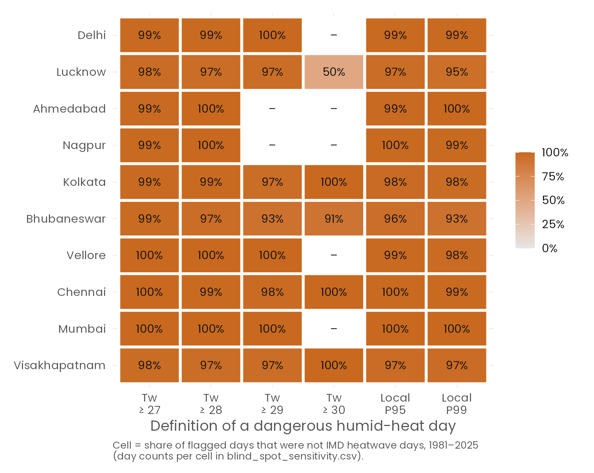

*Figure 6.* Miss rate under absolute and city-specific (local percentile) definitions of a dangerous day.

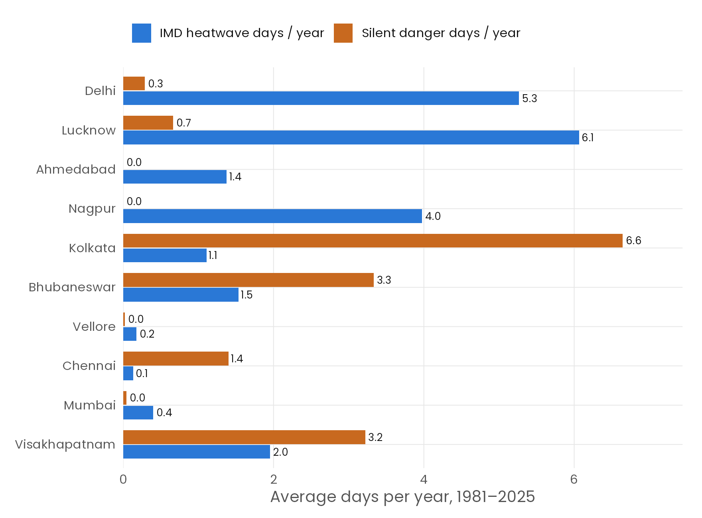

*Figure 7.* Average days per year. In Kolkata, Bhubaneswar, Visakhapatnam and Chennai, silent danger days outnumber official heatwave days.

## 6. RQ2: Is it getting worse?

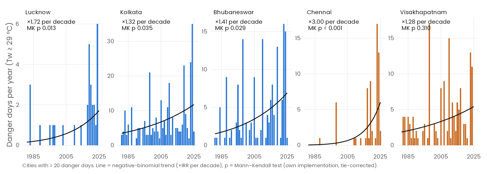

*Figure 8.* Annual danger days with per-city negative-binomial trend lines and Mann–Kendall p-values. The test is our own tie-corrected implementation, cross-checked against base R's `cor.test(method = "kendall")`. Because most years have zero danger days, the Theil–Sen median slope is often exactly 0 even when the trend is significant. Sen slopes are therefore reported in `trend_mann_kendall.csv`, and the count model is used for effect sizes.

* **Count regression:** in a negative-binomial GLM with city fixed effects, danger days rise by a factor of **1.54 per decade** (95% CI 1.34–1.77, p = < 0.001). The Poisson model is badly overdispersed (Pearson dispersion 4.5; LRT p < 0.001).
* **Coastal vs plains:** fitting separate slopes, the increase is 1.76× per decade on the coast and 1.43× on the plains The coastal slope is steeper, but the difference is not significant (LRT for a common slope, p = 0.14).
* **Two-way ANOVA** of April–June mean Tw on city and decade: decade F = 20.0, p = < 0.001. Tukey HSD puts 2021–25 at **+0.53 °C** above 1981–90 (95% CI 0.33–0.73). Residuals are mildly non-normal (Shapiro–Wilk p = < 0.001) and heteroscedastic (Bartlett p = 0.001), so we confirmed the decade effect with the distribution-free **Friedman test**, blocking on city: p = < 0.001. A pooled Kruskal–Wallis test that ignores the city blocks is not significant (p = 0.19). That is a useful lesson in itself: between-city differences dwarf the decade signal unless the design accounts for them.

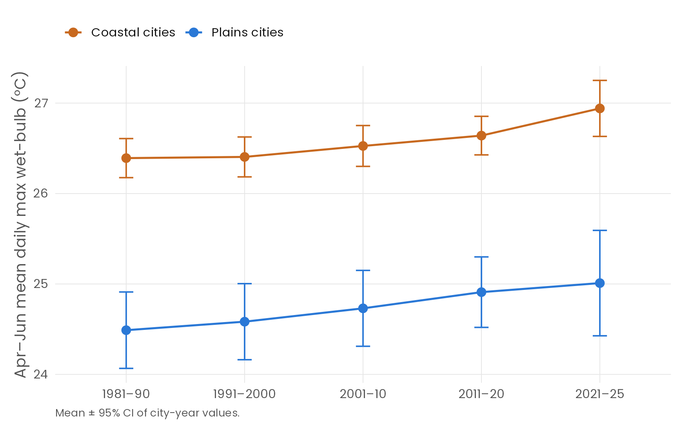


|City          | Danger d/yr 1981–2000| Danger d/yr 2006–2025|Permutation p | AMJ Tw 1981–2000| AMJ Tw 2006–2025|Welch p |KS p    |
|:-------------|---------------------:|---------------------:|:-------------|----------------:|----------------:|:-------|:-------|
|Ahmedabad     |                  0.00|                  0.00|1.000         |           23.963|           24.464|< 0.001 |< 0.001 |
|Bhubaneswar   |                  2.55|                  4.80|0.150         |           27.041|           27.245|0.026   |< 0.001 |
|Chennai       |                  0.35|                  2.85|0.033         |           26.555|           26.950|0.003   |< 0.001 |
|Delhi         |                  0.10|                  0.55|0.155         |           22.505|           22.868|0.044   |0.021   |
|Kolkata       |                  4.80|                  9.05|0.070         |           27.093|           27.336|0.023   |< 0.001 |
|Lucknow       |                  0.35|                  1.15|0.085         |           23.568|           23.980|0.022   |< 0.001 |
|Mumbai        |                  0.00|                  0.10|0.491         |           25.660|           26.020|0.001   |< 0.001 |
|Nagpur        |                  0.00|                  0.00|1.000         |           22.833|           23.412|0.003   |< 0.001 |
|Vellore       |                  0.00|                  0.05|1.000         |           24.749|           24.998|0.019   |< 0.001 |
|Visakhapatnam |                  2.35|                  4.45|0.137         |           26.979|           27.150|0.049   |< 0.001 |

*Table 4.* Early vs recent era. The permutation test uses 10,000 relabellings of years. The KS test compares the full daily April–June distributions.

## 7. RQ3: Extremes and return levels (GEV)

For each city we fit the Generalised Extreme Value distribution to the 45 annual maxima of daily max Tw by maximising

$$\ell(\mu,\sigma,\xi) = -n\log\sigma - (1+1/\xi)\sum_i \log y_i - \sum_i y_i^{-1/\xi},\quad y_i = 1+\xi\frac{z_i-\mu}{\sigma}$$

with our own `optim`-based code (`fit_gev()` in `R/00_setup.R`). Our estimates match `evd::fgev` to every printed digit. Return levels $z_T = \mu - \frac{\sigma}{\xi}\left[1-\{-\log(1-1/T)\}^{-\xi}\right]$ get delta-method and parametric-bootstrap (500 refits) intervals. A non-stationary model with $\mu(t) = \mu_0 + \mu_1 t$ (t in decades) is tested against the stationary one by a likelihood-ratio test.

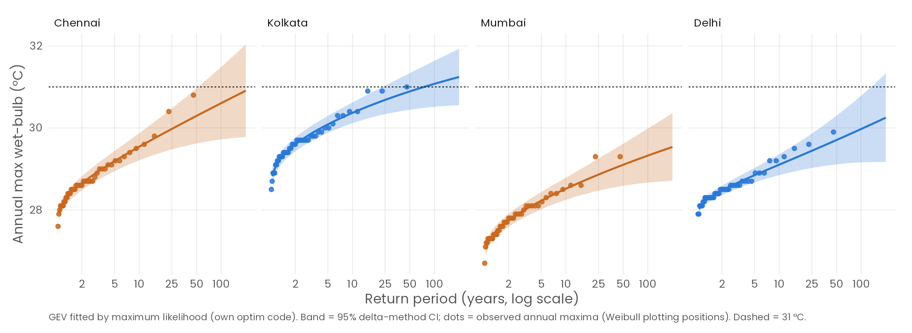

*Figure 9.* Return-level curves with 95% delta-method bands and observed annual maxima.


|City          |μ     |σ    |ξ (SE)       |50-yr level |Bootstrap 95% CI |Trend °C/decade |Trend LRT p |1985's 50-yr event is now 1-in |
|:-------------|:-----|:----|:------------|:-----------|:----------------|:---------------|:-----------|:------------------------------|
|Ahmedabad     |27.88 |0.42 |-0.46 (0.09) |28.63       |28.47 – 28.71    |0.07            |0.048       |6.1                            |
|Bhubaneswar   |29.00 |0.29 |0.38 (0.19)  |31.61       |30.25 – 34.99    |0.04            |0.237       |41.8                           |
|Chennai       |28.47 |0.49 |-0.02 (0.09) |30.29       |29.59 – 31.16    |0.25            |< 0.001     |2.6                            |
|Delhi         |28.36 |0.31 |0.05 (0.11)  |29.70       |29.17 – 30.61    |0.09            |0.020       |24.0                           |
|Kolkata       |29.42 |0.49 |-0.15 (0.09) |30.89       |30.40 – 31.39    |0.15            |0.007       |6.8                            |
|Lucknow       |28.59 |0.31 |0.22 (0.12)  |30.51       |29.63 – 32.36    |0.06            |0.133       |36.8                           |
|Mumbai        |27.58 |0.46 |-0.08 (0.09) |29.10       |28.54 – 29.66    |0.16            |0.010       |5.8                            |
|Nagpur        |26.98 |0.37 |0.04 (0.14)  |28.54       |27.97 – 29.32    |0.19            |< 0.001     |4.0                            |
|Vellore       |26.51 |0.46 |0.04 (0.07)  |28.44       |27.66 – 29.51    |0.18            |< 0.001     |12.3                           |
|Visakhapatnam |28.99 |0.39 |-0.13 (0.11) |30.20       |29.77 – 30.60    |0.05            |0.320       |19.3                           |

*Table 5.* GEV parameters, 50-year return levels and the non-stationary shift.

The location of the humid-heat extreme distribution is rising significantly (LRT p < 0.05) in 7 of 10 cities. **Chennai's** shift is 0.25 °C per decade, so the annual maximum that was a 1-in-50-year event in 1985 is now expected about **once every 2.6 years**. For **Kolkata** the figure is once every 6.8 years. Under the trend model, the chance that Kolkata sees at least one ≥ 31 °C wet-bulb day in 2026–2035 is 35%.

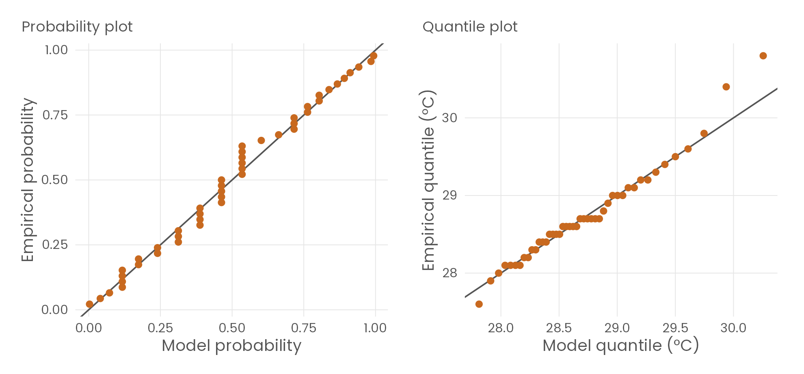

*Figure 10.* GEV probability and quantile plots for Chennai. Points lie close to the diagonal.

## 8. RQ4: Spells — a Markov chain view

Within each city's 61-day peak humid season, we model the day-to-day state (calm/danger) as a first-order, two-state Markov chain. For example, in Kolkata P(danger | danger yesterday) = 0.57, while P(danger | calm yesterday) = 0.05. Independence of consecutive days is decisively rejected in every city (χ² and G² p < 0.001; persistence odds ratios 27–41).

The chain implies geometrically distributed spell lengths with mean 1/(1 − p₁₁). That matches the observed means (2.09, 1.59, 2.32, 2.07 vs 2.09, 1.61, 2.32, 2.07 days), and a χ² goodness-of-fit test does not reject the geometric law (p = 0.10, 0.15, 0.41, 0.67). The chain's stationary probability also reproduces the observed danger frequency almost exactly.

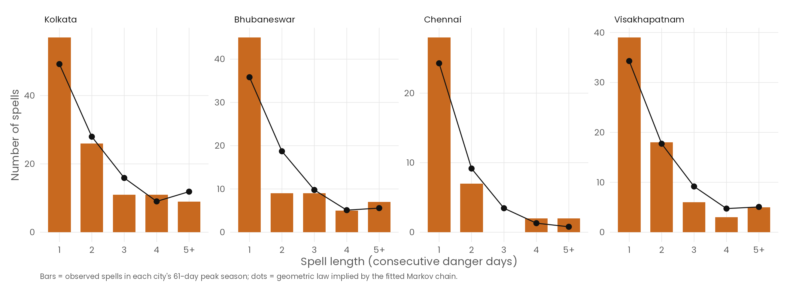

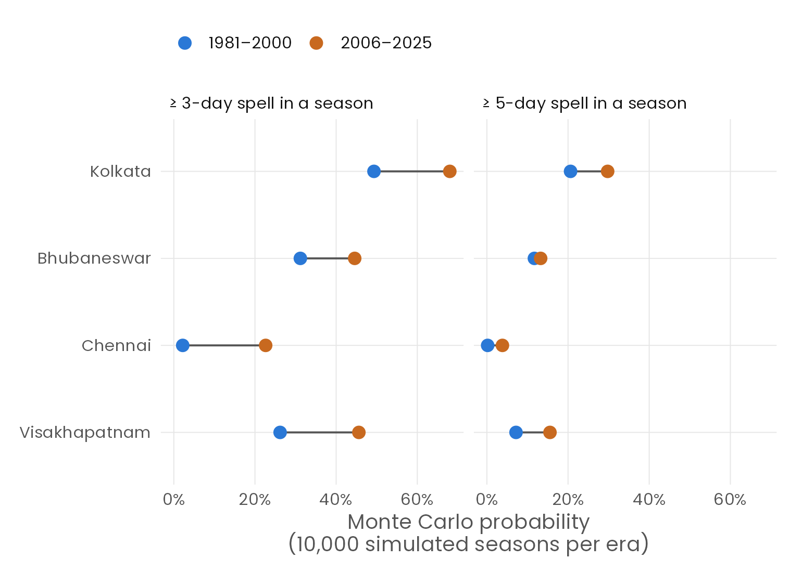

*Figure 11.* Monte Carlo (10,000 simulated seasons per era) using chains estimated separately for 1981–2000 and 2006–2025. In Chennai, the chance of a ≥ 3-day danger spell in a season rose from 2% to 23%. In Kolkata it rose from 49% to 68%.

## 9. RQ5: A probabilistic early warning

We fit a logistic regression for P(danger tomorrow) on 1981–2014 and test it on the unseen years 2015–2025. Predictors are today's max wet-bulb, its day-on-day change, Tmax, RHmin, Tmin, a decadal trend, and a city-specific seasonal cycle. It is compared with three baselines: climatology (seasonal base rate), persistence (P(tomorrow | today)), and the IMD-rule state (P(tomorrow | IMD heatwave today)).


|Model          | Brier| Brier skill vs climatology| Log-loss|   AUC| AUC lo| AUC hi|
|:--------------|-----:|--------------------------:|--------:|-----:|------:|------:|
|Climatology    | 0.022|                      0.000|    0.121| 0.870|  0.853|  0.888|
|IMD-rule state | 0.023|                     -0.059|    0.121| 0.611|  0.577|  0.644|
|Persistence    | 0.019|                      0.106|    0.096| 0.753|  0.720|  0.785|
|Logistic model | 0.018|                      0.175|    0.093| 0.917|  0.900|  0.934|

*Table 6.* Test-period skill. The AUC confidence intervals use the DeLong method. The logistic model beats persistence (DeLong Z = 10.4, p < 0.001).

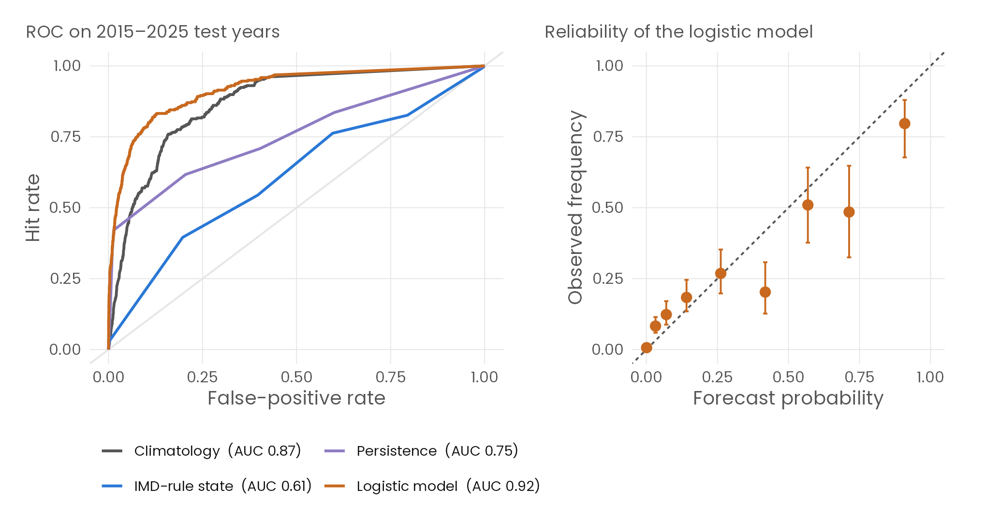

*Figure 12.* ROC curves and the reliability diagram (Wilson 95% intervals). Points near the diagonal mean the probabilities can be taken at face value.


|Warning rule               | Hits| False alarms| Misses|   POD|   FAR|   CSI|
|:--------------------------|----:|------------:|------:|-----:|-----:|-----:|
|IMD heatwave today         |   12|          104|    304| 0.038| 0.897| 0.029|
|Danger today (persistence) |  133|          183|    183| 0.421| 0.579| 0.267|
|Logistic p ≥ 0.17 (max F1) |  146|          229|    170| 0.462| 0.611| 0.268|
|Logistic p ≥ 0.50          |   89|           54|    227| 0.282| 0.378| 0.241|

*Table 7.* Used as a warning, "IMD heatwave today" detects only 4% of next-day danger days. Each +1 °C of today's wet-bulb multiplies the odds of danger tomorrow by 11.3 (95% CI 7.5–17.1).

## 10. Discussion and recommendations

1. **Add a humid-heat trigger to heatwave declarations.** A wet-bulb or heat-index criterion would capture the ~96% of dangerous days the dry-bulb rule misses. IMD's experimental Heat Index already flagged 81% of them.
2. **Use local, probabilistic thresholds.** City-specific return levels (Table 5) and next-day probabilities (Section 9) turn a binary rule into a risk statement that a Heat Action Plan can act on.
3. **Prioritise the east coast and Gangetic West Bengal.** Kolkata, Bhubaneswar, Visakhapatnam and Chennai carry the largest silent burden, and danger days there are rising fastest.

**Limitations.** ERA5's 0.25° grid smooths local extremes and under-represents peak wet-bulb values (only 2 grid-days reached 31 °C). Mumbai's grid cell is strongly sea-moderated. Station data would raise every count, but the dry/humid separation is structural, not an artefact. We approximate IMD's two-station rule with one grid cell, which flatters IMD. Physiological thresholds come from studies of young, healthy adults, so risk for older or outdoor-working people starts lower. Daily dependence is handled with year-block resampling and Markov models, but some p-values from day-level tests remain approximate. GEV trend extrapolation beyond 2025 assumes the recent trend continues.

## 11. Conclusion

India's official heatwave rule and physiologically dangerous humid heat describe almost disjoint sets of days. Using a full probability-and-statistics workflow in R (distribution fitting, hypothesis tests, confidence and credible intervals, count regression, extreme-value theory, Markov chains, Monte Carlo and logistic forecasting), we showed three things. The blind spot is large (~96%), uniform across cities, robust to definitions, and growing. And it is fixable with a probabilistic, humidity-aware early warning.

## Reproducibility

```
Rscript run_all.R                     # download → analysis → figures → this report
Rscript -e 'shiny::runApp("app")'     # interactive dashboard
```

R 4.6.1; packages: dplyr, tidyr, ggplot2, patchwork, ggridges, scales, jsonlite, fitdistrplus, MASS, evd, pROC, shiny, bslib, knitr, markdown. The core statistical routines (GEV likelihood and return levels, Mann–Kendall/Sen, Wilson interval, Cohen's κ, Markov chain estimation and simulation, block bootstrap, permutation test, Stull wet-bulb, NWS heat index) are implemented from first principles in `R/00_setup.R` and the module scripts.

## References

1. India Meteorological Department. *Criteria for heat wave and cold wave* (heat-wave bulletin definitions).
2. Pillai, A. V., & Dalmia, T. (2023). *How is India adapting to heatwaves? An assessment of heat action plans with insights for transformative climate action.* Centre for Policy Research, New Delhi.
3. Vecellio, D. J., Wolf, S. T., Cottle, R. M., & Kenney, W. L. (2022). Evaluating the 35 °C wet-bulb temperature adaptability threshold for young, healthy subjects (PSU HEAT Project). *Journal of Applied Physiology*, 132(2), 340–345.
4. Raymond, C., Matthews, T., & Horton, R. M. (2020). The emergence of heat and humidity too severe for human tolerance. *Science Advances*, 6(19), eaaw1838.
5. Stull, R. (2011). Wet-bulb temperature from relative humidity and air temperature. *Journal of Applied Meteorology and Climatology*, 50(11), 2267–2269.
6. Rothfusz, L. P. (1990). *The heat index equation.* NWS Southern Region Technical Attachment SR 90-23.
7. Coles, S. (2001). *An Introduction to Statistical Modeling of Extreme Values.* Springer.
8. Hersbach, H., et al. (2020). The ERA5 global reanalysis. *Quarterly Journal of the Royal Meteorological Society*, 146, 1999–2049. Accessed via Open-Meteo (Zippenfeld, 2023), CC BY 4.0.
9. Sen, P. K. (1968). Estimates of the regression coefficient based on Kendall's tau. *JASA*, 63, 1379–1389; Mann, H. B. (1945). Nonparametric tests against trend. *Econometrica*, 13, 245–259.
10. DeLong, E. R., DeLong, D. M., & Clarke-Pearson, D. L. (1988). Comparing the areas under two or more correlated ROC curves. *Biometrics*, 44, 837–845.

## Appendix: core R implementations


``` r
mann_kendall <- function(x, conf = 0.95) {
  x <- x[!is.na(x)]
  n <- length(x)
  ij <- which(upper.tri(matrix(0, n, n)), arr.ind = TRUE)  # pairs i < j
  i <- ij[, 1]; j <- ij[, 2]
  S <- sum(sign(x[j] - x[i]))
  ties <- table(x); ties <- ties[ties > 1]
  varS <- (n * (n - 1) * (2 * n + 5) - sum(ties * (ties - 1) * (2 * ties + 5))) / 18
  Z <- if (S > 0) (S - 1) / sqrt(varS) else if (S < 0) (S + 1) / sqrt(varS) else 0
  slopes <- sort((x[j] - x[i]) / (j - i))
  N <- length(slopes)
  C <- qnorm(1 - (1 - conf) / 2) * sqrt(varS)
  lo <- slopes[max(1, floor((N - C) / 2))]
  hi <- slopes[min(N, ceiling((N + C) / 2) + 1)]
  data.frame(n = n, S = S, var_S = varS, Z = Z, p_value = 2 * pnorm(-abs(Z)),
             tau = S / (n * (n - 1) / 2), sen_slope = median(slopes),
             sen_lo = lo, sen_hi = hi)
}
```


``` r
gev_nll <- function(par, z, t = NULL) {
  # par = (mu0, [mu1], log_sigma, xi); location linear in covariate t if given
  if (is.null(t)) { mu <- par[1]; sigma <- exp(par[2]); xi <- par[3] }
  else            { mu <- par[1] + par[2] * t; sigma <- exp(par[3]); xi <- par[4] }
  y <- 1 + xi * (z - mu) / sigma
  if (any(y <= 0) || sigma <= 0) return(1e10)
  if (abs(xi) < 1e-6) {
    s <- (z - mu) / sigma
    return(length(z) * log(sigma) + sum(s) + sum(exp(-s)))
  }
  length(z) * log(sigma) + (1 + 1 / xi) * sum(log(y)) + sum(y^(-1 / xi))
}

fit_gev <- function(z, t = NULL) {
  start <- c(mean(z) - 0.45 * sd(z), log(0.78 * sd(z)), -0.1)
  if (!is.null(t)) start <- c(start[1], 0, start[2:3])
  best <- NULL
  for (xi0 in c(-0.3, -0.1, 0.1)) {
    s <- start; s[length(s)] <- xi0
    f <- optim(s, gev_nll, z = z, t = t, method = "Nelder-Mead",
               control = list(maxit = 5000, reltol = 1e-12))
    f <- optim(f$par, gev_nll, z = z, t = t, method = "BFGS",
               control = list(maxit = 1000, reltol = 1e-12))
    if (is.null(best) || f$value < best$value) best <- f
  }
  p <- best$par
  # Report on the natural scale and get the observed information there
  nat <- p; nat[length(nat) - 1] <- exp(p[length(p) - 1])
  nll_nat <- function(q) { q2 <- q; q2[length(q2) - 1] <- log(q[length(q) - 1])
                           gev_nll(q2, z = z, t = t) }
  H <- optimHess(nat, nll_nat)
  V <- tryCatch(solve(H), error = function(e) MASS::ginv(H))
  nm <- if (is.null(t)) c("mu", "sigma", "xi") else c("mu0", "mu1", "sigma", "xi")
  names(nat) <- nm; dimnames(V) <- list(nm, nm)
  list(par = nat, vcov = V, se = sqrt(pmax(diag(V), 0)), loglik = -best$value,
       n = length(z), conv = best$convergence)
}

# Return level for return period T (years) and its delta-method standard error
gev_return_level <- function(fit, T, mu_override = NULL) {
  mu <- if (is.null(mu_override)) fit$par["mu"] else mu_override
  sigma <- fit$par["sigma"]; xi <- fit$par["xi"]
  yp <- -log(1 - 1 / T)
  z  <- mu - sigma / xi * (1 - yp^(-xi))
  grad <- c(1,
            -(1 - yp^(-xi)) / xi,
            sigma * (1 - yp^(-xi)) / xi^2 - sigma / xi * yp^(-xi) * log(yp))
  se <- sqrt(as.numeric(t(grad) %*% fit$vcov[c("mu", "sigma", "xi"),
                                              c("mu", "sigma", "xi")] %*% grad))
  data.frame(T = T, level = unname(z), se = se)
}
```
